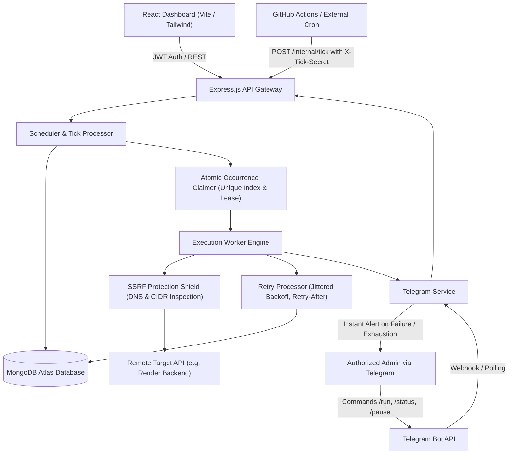
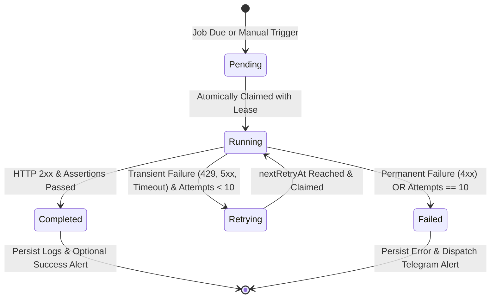

# Apna Scheduler OS — Architecture & Distributed Design

This document details the internal architecture, state transitions, locking protocols, and safety guarantees of **Apna Scheduler OS**.

---

## 1. System Topology & Component Interactions



---

## 2. Distributed Locking & Atomic Occurrence Claiming

To prevent concurrent worker nodes or overlapping tick triggers from executing the same scheduled job twice, Apna Scheduler OS uses a three-tier protection system:

### A. Distributed Tick Lock (`SystemLock`)
When the in-process timer or external tick runs, it attempts an atomic leader acquisition:
```javascript
const lock = await SystemLock.findOneAndUpdate(
  {
    lockName: 'in_process_tick',
    $or: [{ expiresAt: { $lt: now } }, { lockedBy: WORKER_ID }]
  },
  { $set: { lockedBy: WORKER_ID, lockedAt: now, expiresAt } },
  { upsert: true, new: true }
);
```
If another instance currently holds the active lock, execution yields immediately.

### B. Unique Occurrence Indexing (`occurrenceId`)
Every scheduled job execution generates a deterministic occurrence key:
$$\text{occurrenceId} = \text{jobId} + \text{"\_"} + \text{scheduledFor.toISOString()}$$
For manual runs, a unique UUID suffix is appended.
The `executions` collection enforces a unique index on `occurrenceId`:
```javascript
executionSchema.index({ occurrenceId: 1 }, { unique: true });
```
Even if two workers query the same due job at the exact same millisecond, only the first `Execution.create()` will succeed. The second worker will receive a MongoDB `11000` duplicate key violation and will safely skip the execution without duplicating the HTTP side effect.

### C. Worker Leases (`lockedUntil`)
Each running execution holds a time-limited lease (`now + timeout + 15s`). If a worker crashes or restarts mid-flight (e.g. Render container recycling), the **Stuck Execution Monitor** automatically identifies abandoned executions where `lockedUntil < now` and transitions them to `failed` or queues them for recovery.

---

## 3. Execution Lifecycle & Retry State Machine



### Retry Calculation
- Default Strategy: **Fixed** (5-second delay).
- Configurable Strategy: **Exponential with Jitter**:
  $$\text{Delay} = \min\left(3600, \text{BaseDelay} \times 2^{(\text{attempt} - 1)}\right) \pm 20\% \text{ Jitter}$$
- If the target API responds with a `Retry-After: <seconds>` or HTTP date header, the scheduler extracts and honors that delay directly.

---

## 4. SSRF Defense in Depth

Target URLs submitted by users undergo rigorous validation:

1. **Protocol Check**: Only `http:` and `https:` schemes are permitted. Schemes like `file:`, `gopher:`, `ftp:`, or `data:` are rejected.
2. **Hostname Blacklist**: Direct blocks on `localhost`, `127.0.0.1`, `0.0.0.0`, `::1`, `169.254.169.254` (cloud metadata), and `metadata.google.internal`.
3. **DNS Resolution & IP Inspection**: The system resolves hostnames to actual IPv4 and IPv6 addresses via `dns.promises.lookup` and checks them with `ipaddr.js`. Any IP falling inside private subnets (`10.0.0.0/8`, `172.16.0.0/12`, `192.168.0.0/16`, `fe80::/10`) is blocked before the socket opens.
4. **Redirect Hop Inspection**: Outbound HTTP requests disable automatic redirect following (`maxRedirects: 0`). The worker intercepts `301`, `302`, `307`, and `308` responses, parses the `Location` header, runs the SSRF validation suite on the redirect target, and only then initiates the subsequent hop (capped at 5 hops).

---

## 5. Misfire Policies

When an instance wakes up after being asleep or offline, jobs whose `nextRunAt` is in the past are evaluated against their configured policy:

- **`run-once` (Default)**: Executes a single run to satisfy the missed schedule window, then advances `nextRunAt` to the next upcoming future occurrence.
- **`skip`**: Drops all missed occurrences without executing them and sets `nextRunAt` to the next future timestamp.
- **`run-all`**: Catches up on overdue intervals (safety capped at 5 executions) before resuming normal cadence.
